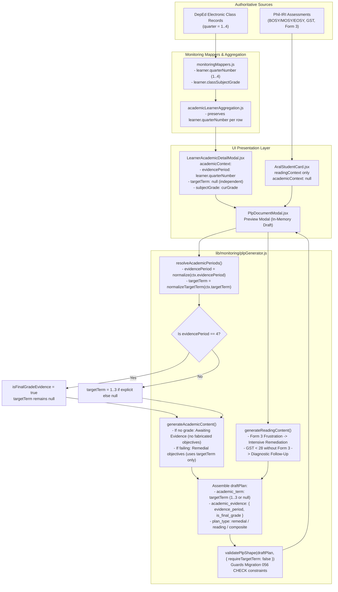

# CNHS LEARN — Academic Evidence to Personalized Learning Plan (PLP) Flow Documentation

## 1. Non-Technical Overview
In CNHS LEARN, a **Personalized Learning Plan (PLP)** is an educational intervention document designed to support learners who are academically struggling or need reading assistance under the Academic Recovery and Accessible Learning (ARAL) program.

Crucially, **evidence of past academic performance** (e.g., a grade received in a past term, or a final year-end grade) is distinct from the **target instructional period** of an intervention plan. For example, a failing grade recorded in Term 1 may inform an intervention planned for Term 2. 

Furthermore, under Department of Education (DepEd) policy and CNHS academic guidelines:
1. There are **three (3) academic instructional terms**: **Term 1**, **Term 2**, and **Term 3**.
2. **Final Grade / Average** is a computed cumulative outcome stored for backward compatibility under database key `quarter = 4`. It is **never** a fourth instructional period or a valid target term for teaching objectives.
3. Reading interventions (Phil-IRI / ARAL) at the Beginning of School Year (BOSY) can be generated independently without requiring finalized academic grades.

---

## 2. Authoritative Data Sources & ECR Query Pipeline

```
[DepEd Electronic Class Records (ECR) / DB Tables]
   │
   ├── Database: `classes` (id, subject, grade_level, section_id, quarter)
   ├── Database: `grades` / `class_grades` (class_id, student_id, quarter, raw_score, quarterly_grade)
   ├── Database: `phil_iri_assessments` (student_id, assessment_period, gst_score, reading_profile)
   │
   ▼
[Server Queries / Repository Layer]
   │
   ├── `lib/supabase/queries/monitoring.js`:
   │     - `fetchTeacherAcademicMonitoringData`: Queries active classes and student quarterly grades.
   │
   ▼
[Data Mappers & Aggregation Layer]
   │
   ├── `lib/teacher/monitoringMappers.js`:
   │     - Maps raw database rows to UI learner rows.
   │     - Attaches `classInfo.quarter` as `learner.quarterNumber` (integer 1–4) and `quarter` (label).
   │     - Extracts `classSubjectGrade` / `curGrade` from quarterly records.
   │
   ├── `lib/monitoring/academicLearnerAggregation.js`:
   │     - `aggregateAcademicLearners()`: Collapses multi-class records into section rosters per quarter while preserving each row's `quarterNumber`.
   │
   ▼
[UI Monitoring Containers]
   │
   ├── `components/teacher/monitoring/MonitoringDashboard.jsx`:
   │     - `viewQuarterNumber`: Derived from teacher's active quarter filter.
   │
   ├── `components/monitoring/shared/LearnerAcademicDetailModal.jsx`:
   │     - Opens detailed modal for an individual learner.
   │     - Maps learner's verified `activeLearner.quarterNumber ?? currentQuarterNumber` into `academicContext.evidencePeriod`.
   │     - Explicitly leaves `academicContext.targetTerm = null` unless an authorized instructional target is supplied.
   │
   ├── `components/teacher/aral-program/AralStudentCard.jsx`:
   │     - Handles pure reading (ARAL) learners.
   │     - Invokes PLP modal with `readingContext` and `academicContext = null` (Reading-Only BOSY flow).
   │
   ▼
[PLP Modal & Generation Engine]
   │
   ├── `components/monitoring/plp/PlpDocumentModal.jsx`:
   │     - Calls `generateDraftPlp({ student, academicContext, readingContext, schoolYear })`.
   │     - Displays preview with teacher-customizable in-memory state.
   │
   └── `lib/monitoring/plpGenerator.js`:
         - Pure, stateless logic engine (zero direct DB queries).
         - Resolves `evidencePeriod` and `targetTerm` independently.
         - Enforces shape constraints matching `056_create_personalized_learning_plans.sql`.
```

---

## 3. Verified Data-Contract & Property Dictionary

The following table reflects **verified properties** used in the codebase:

| Object / Scope | Property Name | Verified Type | Meaning & Constraints |
| :--- | :--- | :--- | :--- |
| **Learner Row** (`detail` / `learner`) | `quarterNumber` | `number` (1–4) | The grading period of the source class record. 1–3 = Term 1–3; 4 = Final Grade. |
| **Learner Row** | `classSubjectGrade` / `currentGrade` | `number \| null` | The numerical grade (0–100) recorded in the electronic class record for this subject/quarter. |
| **Learner Row** | `subject` / `classSubject` | `string` | Curriculum learning area (e.g., "Mathematics", "English", "Science"). |
| **Learner Row** | `isProvisional` | `boolean` | Flag indicating incomplete term evaluation; prevents premature risk labeling. |
| **`academicContext`** | `evidencePeriod` | `number \| null` | The academic term when the grade was recorded (1–3, or 4 for Final Grade). Aliases: `term`, `quarterNumber`. |
| **`academicContext`** | `targetTerm` | `number \| null` | The instructional period the plan targets. Valid values: **1, 2, 3, or null**. **Never 4**. |
| **`academicContext`** | `subjectGrade` | `number \| null` | The numerical grade evaluated for remediation. |
| **`academicContext`** | `classId` | `string \| null` | Identifier of the class. Required for `academic_remedial` and `composite`. |
| **`readingContext`** | `readingPeriod` | `string` | Assessment window (`"BOSY"`, `"MOSY"`, `"EOSY"`). |
| **`readingContext`** | `form3ReadingProfile` | `string \| null` | Verified Phil-IRI Form 3 profile (`"Frustration"`, `"Instructional"`, `"Independent"`). |
| **`readingContext`** | `gstScore` | `number \| null` | Group Screening Test score (0–40). Score < 28 indicates individual assessment needed. |
| **`draftPlan`** | `academic_term` | `number \| null` | Target instructional term stored in DB column. Must be **1–3** (or `null` for reading-only). |
| **`draftPlan`** | `academic_evidence` | `object` | Metadata block tracking `evidence_period`, `evidence_period_label`, and `is_final_grade_evidence`. |
| **`draftPlan`** | `plan_type` | `string` | `"academic_remedial"`, `"reading_aral"`, or `"composite"`. |

---

## 4. Evidence Period vs. Target Term Distinction

A primary source of academic inconsistency is confounding **when evidence occurred** with **what instructional term is being planned**.

- **Evidence Period (`evidencePeriod`)**:
  - Indicates the historical grading period from which the academic assessment originated.
  - Can be **Term 1**, **Term 2**, **Term 3**, or **Final Grade** (`quarter = 4`).
  - Recorded in `academic_evidence.evidence_period` and formatted into learning need descriptions (e.g., *"Intensive remediation required in Mathematics (Current Grade: 70, Term 1)"*).
- **Target Term (`targetTerm`)**:
  - Indicates the intended period for instructional support and competency recovery.
  - Must be independently supplied or validated as an instructional term (**1, 2, or 3**).
  - Can be `null` in draft previews when an instructional target term has not yet been selected by the teacher.
  - Formatted into target objectives (e.g., *"Attain a passing mark (≥ 75%) in Mathematics for Term 2."*).
  - If `targetTerm` is `null`, the objective is cleanly phrased without a fabricated term label (*"Attain a passing mark (≥ 75%) in Mathematics."*).
- **Strict Invariant**:
  - `targetTerm` is **NEVER** assigned automatically from `evidencePeriod`.
  - `quarter = 4` (Final Grade) can **NEVER** be assigned to `targetTerm`.

---

## 5. Final Grade Legacy Storage Explanation

- **Database Column**: PostgreSQL integer column `quarter` in table `grades` / `class_grades`.
- **Legacy Storage Slot**: DepEd trimesters historically utilize slots 1, 2, 3 for active terms and slot 4 for the computed cumulative Final Grade.
- **Handling in CNHS LEARN**:
  - `lib/academic/termLabels.js`: Formats quarter 4 as `"Final Grade / Average"` (or short `"Final"`), never `"Term 4"`.
  - `supabase/migrations/056_create_personalized_learning_plans.sql`: Enforces check constraint:
    ```sql
    academic_term integer check (academic_term between 1 and 3)
    ```
  - In `plpGenerator.js`: `normalizeTargetTerm(4)` strictly resolves to `null`. Final Grade evidence is acknowledged as summary evidence (`is_final_grade_evidence: true`) without creating an invalid `academic_term = 4`.

---

## 6. Reading-Only (BOSY) Workflow

- At the Beginning of the School Year (BOSY), Phil-IRI screening tests (GST) and Form 3 individual diagnostic assessments are conducted before classroom subject quarterly grades are finalized.
- When `readingContext` has a verified need (e.g., `form3ReadingProfile = "Frustration"` or `gstScore < 28` requiring assessment follow-up) and no `academicContext.classId` is supplied:
  - `plan_type` is assigned to `PLP_PLAN_TYPE.READING_ARAL`.
  - `class_id` is set to `null`.
  - `academic_term` is set to `null`.
  - `reading_period` is set to `"BOSY"` (or current assessment period).
- This structure strictly complies with Migration 056 check constraints for reading plans and operates completely independent of quarterly academic grades.

---

## 7. Current Architectural Limitations & Unverified Assumptions

1. **Persistence Feature Flag**:
   - `FEATURE_PLP_PERSISTENCE = false` in `lib/supabase/queries/plpQueries.js`.
   - In the current Stage A architecture, PLP drafting is **purely in-memory preview**. No rows are written to `personalized_learning_plans`.
2. **Target Term Assignment**:
   - The UI currently opens the PLP modal in draft preview mode. Because the teacher has not yet picked a target recovery term, `targetTerm` defaults to `null`, ensuring no term is fabricated.
   - When Stage B persistence is activated, teachers will be able to select the target term (Term 1, 2, or 3) from a dropdown before saving.
3. **Absence of Test Script in `package.json`**:
   - `package.json` has no npm test script; Node test execution is performed via Node.js built-in test runner with ES module alias loader (`node --no-warnings --loader ./scripts/alias-loader.mjs --test <file>`).

---

## 8. Mermaid Process Flowchart


